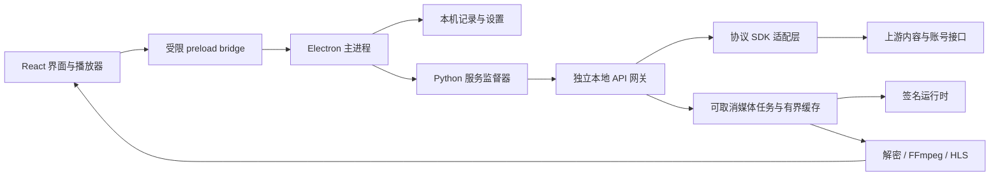

# 客户端架构

红果桌面将界面、桌面能力、内容协议和播放任务分开维护。旧客户端只作为数据迁移来源，不是运行时服务，也不是界面的构建输入。

2026-11-07 起，PC 与 TV 分别维护于 `dddmiku/hongguo-desktop` 和 `dddmiku/hongguo-tv`。常规 PC 发布仅生成 Windows 更新清单，不读取或写入已停更的混合发布仓库。旧仓库保留最终静态迁移清单，不参与后续版本迭代。

1.1.0 将完整观看历史放在 `history.sqlite3`，使用真实观看时间和账号作为合并依据，界面读取有游标的分页。`library.json` 保存设置、收藏及待上报队列；旧 JSON 历史只读迁入数据库后保留固定备份。首页读取公共片单缓存，后续网络刷新与云历史翻页在后台执行。

## 请求与播放链路

渲染进程没有 Node.js 权限；`contextIsolation`、sandbox 和受限 IPC 路由将桌面文件与账号操作留在主进程。主进程启动独立 Python 服务，使用本机随机端口和进程私有令牌。它监督该服务及自己创建的子进程，退出时执行有界清理，启动失败时允许重试。

内容服务对外提供稳定的 `/catalog`、`/account` 和 `/media` 接口。上游响应在适配层规范化，React 使用 `shared/contracts.ts` 中的统一字段，避免界面依赖上游内部形状。

## 本地记录与同步

本机记录按账号隔离。播放进度先落本机，再由后台队列补传；不能把接口读取失败解释为云端没有某条记录。同步失败时保留本地数据，界面明确显示失败状态。

历史由 SQLite 保存完整记录，渲染层使用分页查询和有界近期窗口。云端的观看历史与续播进度是两套独立数据，适配层把同一次真实观看同时写入 `read_history/update` 和 `read_progress/upload`，全部成功才确认队列；重试读取两套真实时间戳，保护手机更新的进度并允许修复部分成功的上报。

首次迁移以只读方式打开旧 SQLite，并只读取固定旧账号文件中的白名单字段。会话由主进程直接交给受保护的本地服务，不进入 React、日志或诊断文件。迁移历史只并入本机库，不生成旧进度上传任务；登录恢复后按正常规则读取云端历史。详见 [迁移说明](migration.md)。

## 媒体与界面生命周期

媒体任务支持取消、状态查询、会话复用与后续剧集预取。空间上限只约束播放缓存，不删除本地历史和收藏。关闭窗口或使用老板键隐藏时，暂停当前视频并保存位置；恢复窗口后由用户继续观看。

整集源就绪后先读取容器头获取完整时长，再生成可逐步播放的 HLS；已生成的片段长度只用于缓冲状态。时间轴、拖动和本机完成判定都使用整集长度。两个固定解码槽保留当前画面直到下一槽的首帧准备完成，再交换画面与音轨。

片单、搜索、详情和评论使用请求世代标记丢弃过期响应。刷新失败时保留已经显示的片单；评论翻页失败时保留已加载内容并提供原地重试。画质与倍速选择后主动释放焦点，播放器控制栏可以重新进入自动隐藏周期。

弹幕读取手机版同一集的时间段数据，视频时间决定弹幕何时入场，可暂停的滚动时钟控制文字移动。首段随播放器准备提前读取，后续按 30 秒窗口预取；切集、拖动、账号切换和刷新隔离过期响应。Canvas 轨道按文字和内嵌表情的实测宽度分配，最多约 60 FPS，暂停时相同画面不重复绘制。手机表情配置版本 7 的 60 个 PNG 随前端构建；已知表情标记显示图片，未知标记保留原文，第三方资源来源见 `src/danmaku/emoji-images/NOTICE.md`。

## 自主外观

界面采用独立设计，不复刻旧客户端的白色设置页或窄图标栏。默认炭黑背景与莓红强调色，以真实剧集封面构成首页主视觉。卡片比例、标题层级、焦点样式、浅色主题、系统主题和窗口尺寸适配都在源码样式中维护。

界面字体使用系统字体，无需远程字体服务。截图来自实际 Electron 客户端与真实片单，保存在 `docs/screenshots/`；测试替身截图不作为正式产品图。

首页与探索片库使用上游题材、设定和背景选择器，分类 ID 随作品类型获取。请求、缓存和分页游标包含完整筛选组合，切换分类从第一页开始，返回时恢复筛选和已浏览内容。

## 构建与第三方运行时

`npm run build` 编译 React 和 Electron 主进程；`npm run package` 将编译产物、独立 Python 服务和已校验的便携运行时打成 NSIS 安装包。

源码与运行时分别发布。`runtime-manifest.json` 固定对应的 runtime ZIP、版本和 SHA-256，`tools/bootstrap-runtime.py` 下载时逐字节校验、限制 ZIP 大小和展开体积，并拒绝路径穿越、符号链接、Windows 保留名与重复路径。所有展开都在项目 `_work/` 中完成，完成验证后才替换固定 `runtime/` 目录。

复用边界包括第三方协议 SDK、加密/解密实现、签名组件及 Python/JRE/FFmpeg/PyAV 依赖。这些依赖随运行时保留许可证；新仓库不运行旧 `server.py`，不依赖旧 EXE，也不重写其内嵌资源。

## 验证边界

CI 使用合成数据和接口替身，检查类型、存储、只读迁移、接口契约、可取消媒体任务和进程生命周期。真实 Electron 验收另外检查片单、播放产物、切集和主题，而不只检查按钮有没有 DOM 变化。

现有会话恢复并不等于已验证短信登录。短信发送、账号验证及 MFA 流程还需要实际账号测试；未经运行的场景不得计入通过项。公开构建工作流只上传安装包 artifact，不执行对外发布。

1.2.1 将同一时间点的弹幕放入有界待显示队列，按密度连续入场；超出单帧显示数量不会立即丢弃整批弹幕。读段提前约 25 秒媒体时间启动，倍速时扩大预取范围，合并时间段保留当前轨道。真实场景没有弹幕时仍保持空白，不复制评论来填屏。

收藏操作先确定目标状态，主进程按账号与作品合并在途请求；服务端读到目标已存在时直接确认，不重复写。失败后只读核对短暂延迟的结果，仍失败则保留原本机状态并返回具体错误。后台同步使用收藏世代隔离旧列表，避免覆盖刚成功的操作。播放器在实际视频区域显示处理中及结果；成功反馈 3 秒、失败反馈 6 秒后收起。

1.2.2 在渲染器通过 MediaCapabilities 核对 HEVC 是否支持、流畅且省电。服务根据真实视频头核对编码与像素格式；可支持的 HEVC/H.264 只复制视频包到 fMP4 HLS，音轨兼容时也直接复制。否则使用兼容 H.264 转码。两条缓存身份分开，HEVC 解码异常可以重新建立兼容会话，不复用不适用的缓存。

下载可并行，视频转换持有单一处理槽；FFmpeg 输入解码与软件编码各限制两线程，以较低优先级运行。活动 HLS 前向目标 18 秒、上限 30 秒；下一集暖槽只需 6 秒缓冲、上限 12 秒，首帧准备完成后停止继续加载，成为活动槽时恢复正常加载。移除额外后两集的转码预取。

播放器会话与页面导航分离。进入账号、设置或片库时组件保留并暂停，返回入口恢复原视频、时间和原暂停状态；明确结束或选择另一播放目标才释放。最小化与隐藏暂停，隐藏播放器不响应快捷键；页面退出后的弹幕不连续绘制。选集列表和弹幕组件避免随每次时间更新重建。

弹幕的入场间隔由滚动耗时、数量预算与密度决定，使已离场的文字逐条补位；轨道选择分散到可用位置，避免稀疏模式填满 12 条后成批等待离场。真实场景时间和有界延迟保持不变，文本和手机表情组成的测宽结果有界复用。暂停/缓冲后恢复用实际媒体推进校正，不把停绘的墙钟时间计为移动。
