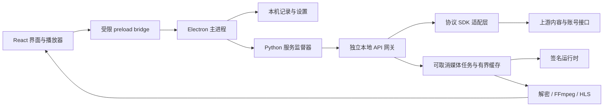

# 客户端架构

红果桌面 1.0 将界面、桌面能力、内容协议和播放任务分开维护。旧客户端只作为数据迁移来源，不是运行时服务，也不是界面的构建输入。

## 请求与播放链路

渲染进程没有 Node.js 权限；`contextIsolation`、sandbox 和受限 IPC 路由将桌面文件与账号操作留在主进程。主进程启动独立 Python 服务，使用本机随机端口和进程私有令牌。它监督该服务及自己创建的子进程，退出时执行有界清理，启动失败时允许重试。

内容服务对外提供稳定的 `/catalog`、`/account` 和 `/media` 接口。上游响应在适配层规范化，React 使用 `shared/contracts.ts` 中的统一字段，避免界面依赖上游内部形状。

## 本地记录与同步

本机记录按账号隔离。播放进度先落本机，再由后台队列补传；不能把接口读取失败解释为云端没有某条记录。同步失败时保留本地数据，界面明确显示失败状态。

首次迁移以只读方式打开旧 SQLite，并只读取固定旧账号文件中的白名单字段。会话由主进程直接交给受保护的本地服务，不进入 React、日志或诊断文件。迁移历史只并入本机库，不生成旧进度上传任务；登录恢复后按正常规则读取云端历史。详见 [迁移说明](migration.md)。

## 媒体与界面生命周期

媒体任务支持取消、状态查询、会话复用与后续剧集预取。空间上限只约束播放缓存，不删除本地历史和收藏。关闭窗口或使用老板键隐藏时，暂停当前视频并保存位置；恢复窗口后由用户继续观看。

片单、搜索、详情和评论使用请求世代标记丢弃过期响应。刷新失败时保留已经显示的片单；评论翻页失败时保留已加载内容并提供原地重试。画质与倍速选择后主动释放焦点，播放器控制栏可以重新进入自动隐藏周期。

## 自主外观

界面采用独立设计，不复刻旧客户端的白色设置页或窄图标栏。默认炭黑背景与莓红强调色，以真实剧集封面构成首页主视觉。卡片比例、标题层级、焦点样式、浅色主题、系统主题和窗口尺寸适配都在源码样式中维护。

界面字体使用系统字体，无需远程字体服务。截图来自实际 Electron 客户端与真实片单，保存在 `docs/screenshots/`；测试替身截图不作为正式产品图。

## 构建与第三方运行时

`npm run build` 编译 React 和 Electron 主进程；`npm run package` 将编译产物、独立 Python 服务和已校验的便携运行时打成 NSIS 安装包。

源码与运行时分别发布。`runtime-manifest.json` 固定对应的 runtime ZIP、版本和 SHA-256，`tools/bootstrap-runtime.py` 下载时逐字节校验、限制 ZIP 大小和展开体积，并拒绝路径穿越、符号链接、Windows 保留名与重复路径。所有展开都在项目 `_work/` 中完成，完成验证后才替换固定 `runtime/` 目录。

复用边界包括第三方协议 SDK、加密/解密实现、签名组件及 Python/JRE/FFmpeg/PyAV 依赖。这些依赖随运行时保留许可证；新仓库不运行旧 `server.py`，不依赖旧 EXE，也不重写其内嵌资源。

## 验证边界

CI 使用合成数据和接口替身，检查类型、存储、只读迁移、接口契约、可取消媒体任务和进程生命周期。真实 Electron 验收另外检查片单、播放产物、切集和主题，而不只检查按钮有没有 DOM 变化。

现有会话恢复并不等于已验证短信登录。短信发送、账号验证及 MFA 流程还需要实际账号测试；未经运行的场景不得计入通过项。公开构建工作流只上传安装包 artifact，不执行对外发布。
